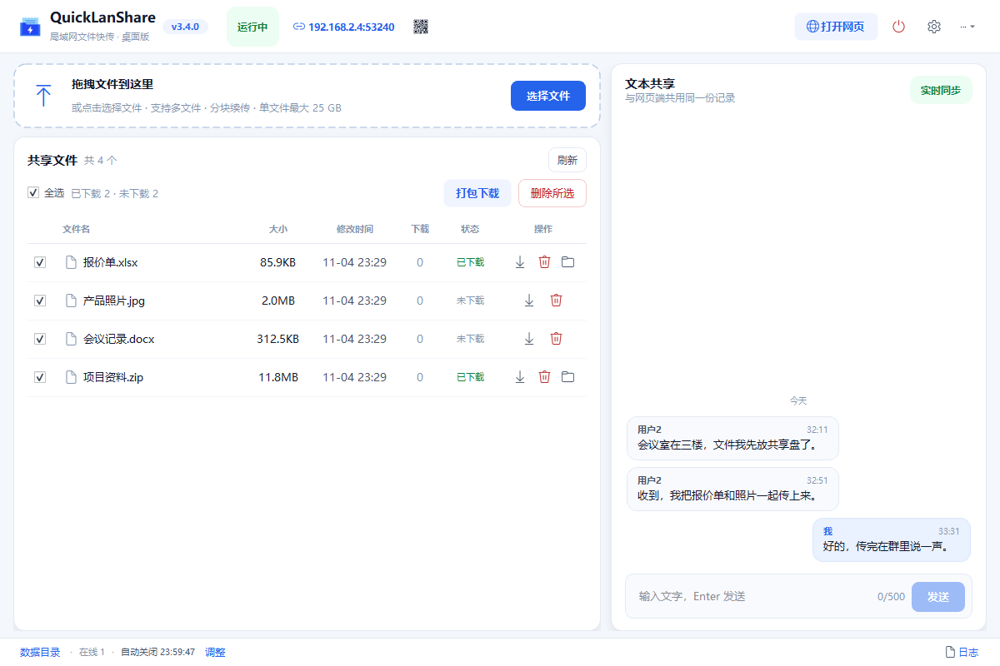

# QuickLanShare v3.4.0 - Copyright © XAF 2026.11

> **局域网文件快传，桌面端也能直接管。**
> 不登录、不上云，拖进去、扫一下，文件就在同事和手机之间跑起来。

QuickLanShare 把「开一个命令行窗口跑服务、再自己找地址」的旧体验，换成了一个浅色、现代的
Windows 桌面应用：服务在后台安静运行，主界面里拖拽上传、下载、看日志；手机或其他电脑
扫码打开网页，照样能传文件、聊天。

---

## 为什么值得试试

| 亮点 | 说明 |
| --- | --- |
| **拖进去就传** | 文件直接拖到窗口任意位置，或点击上传区选择文件；支持多文件、文件夹展开、分块续传 |
| **扫码即用** | 主界面实时显示局域网地址与二维码，手机、平板、其他电脑打开网页就能上传下载，无需安装客户端 |
| **桌面端闭环** | 不用再切浏览器：在应用内下载、批量打包下载、删除、复制下载链接，传输进度一目了然 |
| **下载状态清楚** | 每行显示已下载/未下载/下载中；已下载文件在「操作」列删除右侧有文件夹图标，一键打开所在位置 |
| **下载位置跟随系统** | 默认使用当前用户的「下载」文件夹，自动识别被移动到 D 盘等位置；也可在设置中改为其他目录 |
| **直接下载不弹窗** | 点击下载直接保存到默认目录，重名自动编号；不再每次弹保存对话框 |
| **访问范围可控** | 默认只允许同一网段的设备访问，可放宽到后 2 位、后 3 位或全部放通 |
| **勾选即操作** | 文件前有复选框，表头全选；删除所选、打包下载只作用于勾选的文件 |
| **文字也能即时共享** | 桌面端直接输入文字，和网页端共用同一份记录；电脑、手机看到的内容保持一致 |
| **默认 24 小时自动收工** | 忘记关也不怕：服务默认运行 24 小时后自动关闭程序；需要长期共享可在设置里关闭自动关闭 |
| **数据留在自己电脑** | 只走局域网，不经过云服务，不需要账号；文件、聊天记录、日志都在本机目录里 |

---

## 三步开始

1. **双击运行** `QuickLanShare.exe`（发布包已包含运行环境，目标电脑无需安装 Python）。
2. **把文件拖进窗口**，或点击上传区选择文件；也可以直接在右侧输入文字发给所有人。
3. **手机扫码**（地址旁的小二维码，点击可放大），或让同事在浏览器输入界面上的局域网地址，即可互传文件、查看共享文字。

> 第一次启动如果 Windows SmartScreen 提示“未知发布者”，这是未签名 exe 的正常提示；
> 请核对发布包中的 `SHA256SUMS.txt` 后再决定是否运行。

---

## 你会用到的功能

### 文件

- 拖拽上传、点击选择、文件夹拖入自动展开；
- 分块续传：网络中断后重新选择同一文件会从未完成位置继续；
- 应用内下载、批量打包下载（ZIP）、删除、复制下载链接；
- 文件前复选框 + 全选，删除所选/打包下载只处理勾选文件；
- 每行显示「已下载 / 下载中 / 未下载」；
- 已下载文件在「操作」列删除右侧显示文件夹图标，点击直接在资源管理器中定位；
- 点击下载直接保存到默认下载目录，不再每次弹保存框；重名自动编号；
- 单文件最大 25 GB，分块上传、断点续传；
- 下载计数、文件大小与修改时间一目了然；
- 重名文件自动编号，不覆盖已有文件。

### 文本

- 桌面端右侧「文本共享」直接输入、Enter 发送，最多 500 字；
- 与网页端实时同步，共用同一份聊天记录，不是两套数据；
- 自己的消息靠右显示「我」，其他设备显示「用户N」；右键可复制或删除；
- 断线自动重连，重连期间显示状态，不影响继续发送（发送走 HTTP）。

### 网页端

- 手机扫码加入，网页端可上传、下载、打包、聊天；
- 分块上传、断点续传、流式 ZIP、超大文件下载；
- 在线人数、文件数与消息数实时刷新。

### 桌面端

- 浅色双栏工作台：左侧文件、右侧文本，核心操作在首屏；
- 文件列表加载使用骨架屏过渡，失败可重试；
- 地址旁小二维码：悬停放大，点击在窗口中央放大并压暗其余区域，点击空白处恢复；
- 运行日志收纳在底部抽屉：级别过滤、自动滚动、一键打开日志目录；
- 系统托盘：关闭窗口默认最小化到托盘，服务继续运行；托盘菜单可显示主界面或退出；
- 单实例：重复双击 exe 只会激活已打开的窗口；
- 设置：端口、IP 放通范围、启动后是否自动打开网页、默认下载位置、自动关闭时长、开机自启/静默自启、托盘行为、日志级别。

---

## 自动关闭：默认 24 小时，可改成永不关闭

- 默认：**启动后 24 小时自动关闭服务并退出程序**，适合临时共享、会议传文件、演示等场景。
- 修改：点击「设置」→「自动关闭」→ 调整小时数（0.1～720 小时）。
- 不关闭：在设置中关闭「启用自动关闭」开关，程序会一直运行，直到你手动退出。
- 本机打开的网页保留「自动关闭」开关与延长按钮；其他设备打开的网页隐藏该控制，且服务端拒绝非本机关闭请求。

---

## 访问控制：默认只放通同一网段

- IPv4 地址共四段；默认只放通最后一位，即与本机前三段相同的设备（例如本机 `192.168.1.10`，允许 `192.168.1.x`）。
- 可在「设置」→「访问控制」→「IP 放通范围」中改为：
  - 放通最后 2 位（同前两段）；
  - 放通最后 3 位（同第一段）；
  - 全部放通。
- `127.0.0.1` 本机始终允许，不会被锁死。
- 修改后需重启服务生效；不在范围内的设备访问会收到 403。

---

## 打开网页：默认不自动打开

以前启动后会自动弹浏览器，现在**默认不打开**，避免打断当前工作。

需要时：

- 点击主界面右上角「打开网页」；
- 或在「设置」中开启「启动服务后自动打开网页」。

---

## 开机自启：默认关闭，可静默在托盘

- 默认**不开启**；需要时在「设置」→「启动」中打开「开机自启」。
- 打开后可再勾选「静默自启」：登录 Windows 时不显示主界面，只在系统托盘运行。
- **双击 exe 不受影响**：手动双击始终显示主界面；只有开机自启（带静默参数）才隐藏。
- 关闭「开机自启」会移除注册表启动项。

---

## 下载文件放在哪里

- 默认保存到当前用户的「下载」文件夹；程序读取 Windows 已知文件夹，**即使“下载”已被移动到 D 盘或其他位置也能正确识别**。
- 可在「设置」→「下载」→「默认下载位置」中改为其他目录；「恢复默认」会重新跟随系统设置。
- **点击下载不再弹保存框**，直接保存到默认目录；同名文件自动编号为 `文件 (1).ext`，不会覆盖。
- 文件行「状态」列会显示「已下载 / 下载中 / 未下载」；已下载文件在「操作」列删除右侧的文件夹图标可打开所在位置。
- 表头「全选」可一次勾选当前列表。

---

## 系统要求

| 项目 | 要求 |
| --- | --- |
| 系统 | Windows 10 1809 及以上 / Windows 11，x64 |
| 运行环境 | 无需安装 Python；发布包自带 |
| 磁盘 | 程序目录约 131 MB（含 Qt 运行库），另需存放共享文件的空间 |
| 网络 | 局域网互通即可；无需互联网 |
| 权限 | 普通用户即可；不写注册表、不装服务 |

---

## 常见问题

**为什么浏览器没有自动打开？**

默认关闭，避免打扰。点击「打开网页」即可；也可以在设置中改为启动后自动打开。

**手机扫码后打不开？**

确认手机和电脑在同一个局域网、电脑防火墙允许该端口（默认 8888，被占用会自动顺延，界面会显示实际端口）。
如果电脑有多张网卡，界面显示的是程序选中的局域网地址，可尝试用手机浏览器输入电脑的其他局域网 IP + 端口。

**关闭窗口后程序还在运行？**

这是托盘运行的设计：服务继续提供共享。右键托盘图标选择「退出程序」才会真正结束；
也可以在设置中关闭「关闭窗口时最小化到托盘」。

**24 小时后程序自己关了，文件会丢吗？**

不会。文件保存在程序目录的 `uploads` 文件夹中，重新启动后仍在列表里。

**上传到一半网络断了怎么办？**

重新选择同一个文件即可续传；未完成的分片会在 24 小时后自动清理。

**桌面端发的文字，手机能看到吗？**

能。文本共享和网页端聊天是同一份记录，桌面端发送后网页端实时出现；反过来也一样。

**文本可以发多长？**

单条最多 500 字，和网页端限制一致；换行会被规范为空格。

**下载的文件在哪里找？**

默认在当前用户的「下载」文件夹，程序会自动识别它是否被移动到 D 盘等位置。
可以在「设置」→「下载」中修改默认位置；点击下载会直接保存，不再弹保存框。
文件行「状态」列显示「已下载」后，点「操作」列删除右侧的文件夹图标即可定位。

**开机自启会自己弹出主界面吗？**

默认关闭。开启后如果勾选「静默自启」，登录 Windows 时只在托盘运行、不弹窗；
不勾选则正常显示主界面。手动双击 exe 始终显示主界面，不受静默设置影响。

**为什么第一次运行会提示防火墙？**

Windows 会询问是否允许程序在专用/公用网络通信。只在可信局域网使用，建议仅允许“专用网络”。

**杀毒软件报毒？**

未签名 exe 容易被启发式误报。请从可信来源获取发布包，并使用 `SHA256SUMS.txt` 校验；
企业环境可自行签名后再分发。

---

## 隐私与安全

- 不做账号体系，不上传任何数据到互联网；
- 文件、聊天记录、配置与日志都保存在本机；
- 服务端带 Host / Origin 校验、路径穿越防护、上传大小限制与安全响应头；
- 网页端只能访问共享目录内的文件，不能读取本机其他路径。

---

## 版本、许可与反馈

- 当前版本：**3.4.0**
- 作者：XAF
- 生成物许可：归使用者所有；第三方组件许可见 [THIRD-PARTY-NOTICES.md](THIRD-PARTY-NOTICES.md)
- 开发者文档：[docs/readme.md](docs/readme.md)（项目说明书）、[docs/develop-readme.md](docs/develop-readme.md)（开发手册）
- 问题反馈：请附上 `logs` 目录中对应时间段的日志文件

> QuickLanShare 使用 Qt / PySide6（LGPL-3.0）动态链接分发，详见第三方声明。

---

## 修订记录

| 日期 | 版本号 | 说明 |
| --- | --- | --- |
| 2026-11-04 | 3.4.0 | 下载直接保存到默认目录、单文件上限 25 GB、IPv4 放通范围、桌面端打开本机网页保留关闭控制、数据目录打开 uploads、选择文件默认桌面、文件表数值居中、修复含空格文件名定位 |
| 2026-11-04 | 3.3.0 | 默认下载目录改为当前用户真实“下载”（识别 D 盘等重定向），可在设置中修改/恢复默认 |
| 2026-11-04 | 3.2.2 | 状态列文字改为居中，与表头对齐 |
| 2026-11-04 | 3.2.1 | 移除二维码按钮 tooltip，修复悬停大图被遮挡；连接弹层改为自绘圆角背景，修复四周黑底；文件夹图标移到操作列删除右侧 |
| 2026-11-04 | 3.2.0 | 文件表新增复选框/全选、已下载状态与筛选、打开所在文件夹；地址旁新增小二维码（悬停放大、点击居中遮罩）；设置新增开机自启与静默自启；修复二维码弹层四角黑点 |
| 2026-11-04 | 3.1.0 | 界面重构为「文件 + 文本」双栏工作台；新增桌面端文本共享（与网页端实时同步）；日志改为底部抽屉；顶部连接信息弹层；文件操作精简为图标 |
| 2026-11-04 | 3.0.0 | 由命令行程序改造为 PySide6 桌面应用：拖拽上传、应用内下载、运行日志、浅色现代界面、托盘与单实例；默认 24 小时自动关闭且可配置为不关闭；默认不自动打开网页 |
| 2026-10-30 | 2.2.0 | 安全与可靠性重构，修复大文件下载与打包问题 |
| 2026-10-01 | 2.1.0 | 新增分块续传、流式 ZIP、聊天记录持久化 |
